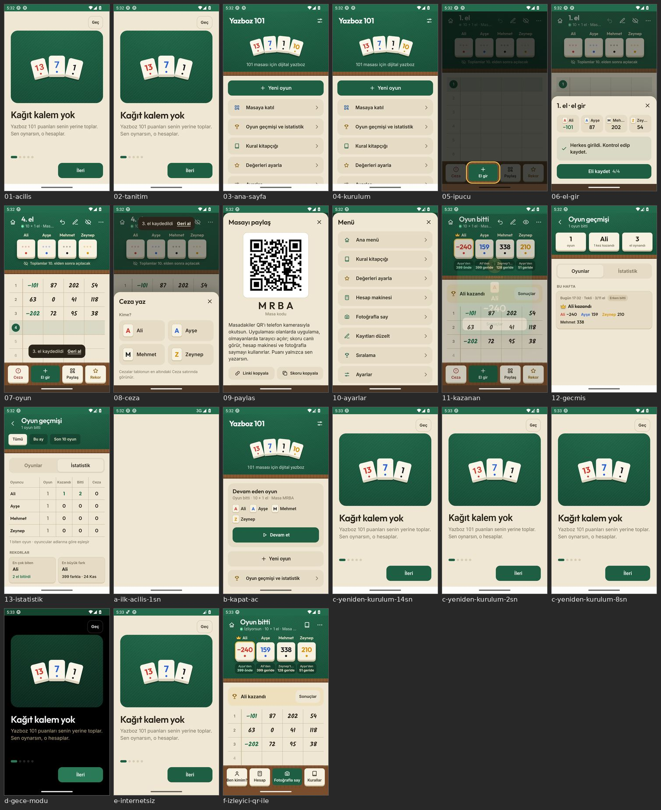
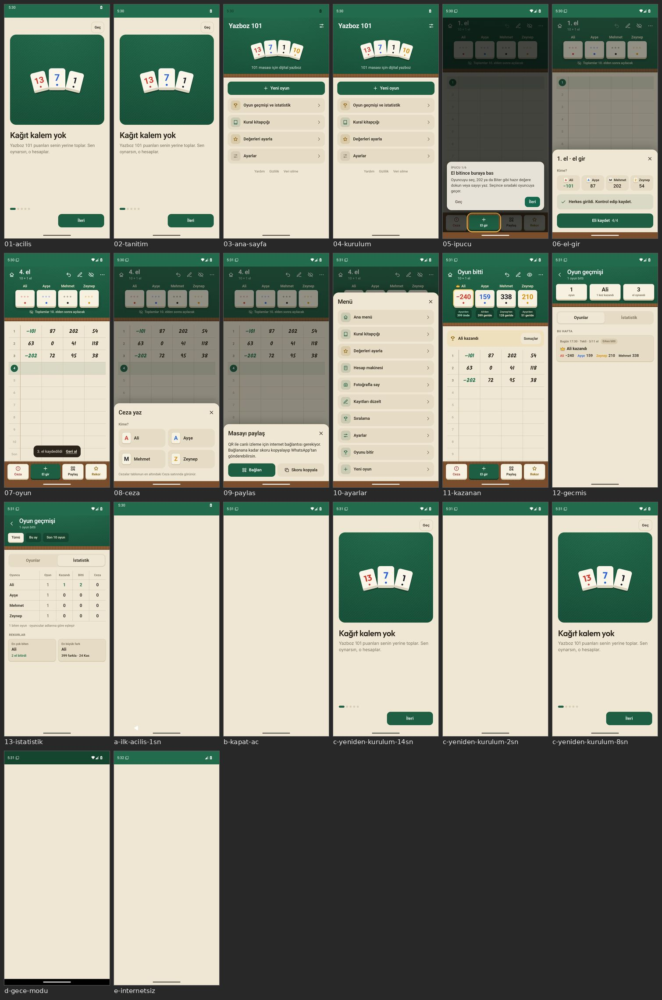
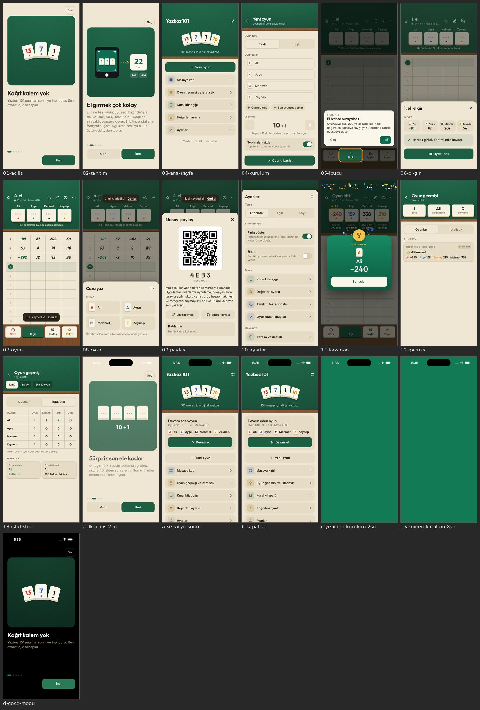

# Yazboz 101 · otomatik deneme sonucu

Çalıştırma: https://github.com/aygunduzalper/yazboz101/actions/runs/45448924486


## ✅ android-33 · sdk_gphone64_x86_64 · Android 13 · 1080x1920

- WebView: com.google.android.webview, 109.0.5414.123
- Ekran 360x592 @3x · ilk ekran 3492 ms · senaryo 32709 ms · canlı paylaşım: açık (16 ms)
- 1 ilk açılış: acilisMs=3212, yuklenme=interactive, tanitim=True, anaSayfa=True, devamEt=False, oyunEkrani=False, yaziUzunlugu=262, sayfaSuresiMs=3486, tema=
- 1b masa sunucuda: kod=MRBA, var=True
- 2 kapat-aç: acilisMs=2626, yuklenme=complete, tanitim=False, anaSayfa=True, devamEt=True, oyunEkrani=False, yaziUzunlugu=263, sayfaSuresiMs=5157, tema=
- 3 sil-yükle-aç: acilisMs=3261, yuklenme=complete, tanitim=True, anaSayfa=True, devamEt=False, oyunEkrani=False, yaziUzunlugu=275, sayfaSuresiMs=11409, tema=, uyariPenceresi=False
- 4 gece modu: yuklenme=complete, tanitim=True, anaSayfa=True, devamEt=False, oyunEkrani=False, yaziUzunlugu=275, sayfaSuresiMs=4678, tema=
- 4b QR ile katılma: ayar=True, sunucu=True, kimlik=True, gonderildi=False, hata=None, kod=None, rol=viewer, izleyici=ok, katilim=MRBA, gorunum=home
- 5 internetsiz açılış: acilisMs=3568, yuklenme=complete, tanitim=True, anaSayfa=True, devamEt=False, oyunEkrani=False, yaziUzunlugu=275, sayfaSuresiMs=5909, tema=

<details><summary>Konsol uyarı ve hataları (1)</summary>

```
[internetsiz] network: Failed to load resource: net::ERR_INTERNET_DISCONNECTED https://yazboz101.com/surum.json?t=1795541619483
```
</details>



## ❌ android-35 · sdk_gphone64_x86_64 · Android 15 · 1080x2400

- WebView: com.google.android.webview, 124.0.6367.219
- ❌ Uygulama çöktü (logcat.txt içinde AndroidRuntime satırları)
- Ekran 412x839 @2.625x · ilk ekran 5325 ms · senaryo 51000 ms · canlı paylaşım: yok (10055 ms)
- 1 ilk açılış: acilisMs=4098, yuklenme=complete, tanitim=True, anaSayfa=True, devamEt=False, oyunEkrani=False, yaziUzunlugu=262, sayfaSuresiMs=5313, tema=
- 1b masa sunucuda: kod=NQWX, ayar=False, not=canlı paylaşım ayarı yok
- 2 kapat-aç: acilisMs=4037, yuklenme=complete, tanitim=False, anaSayfa=True, devamEt=True, oyunEkrani=False, yaziUzunlugu=263, sayfaSuresiMs=5805, tema=
- 3 sil-yükle-aç: acilisMs=2569, yuklenme=complete, tanitim=True, anaSayfa=True, devamEt=False, oyunEkrani=False, yaziUzunlugu=275, sayfaSuresiMs=11824, tema=, uyariPenceresi=False
- 4 gece modu: yuklenme=complete, tanitim=True, anaSayfa=True, devamEt=False, oyunEkrani=False, yaziUzunlugu=275, sayfaSuresiMs=6048, tema=
- 5 internetsiz açılış: acilisMs=1720, yuklenme=complete, tanitim=True, anaSayfa=True, devamEt=False, oyunEkrani=False, yaziUzunlugu=275, sayfaSuresiMs=5300, tema=

<details><summary>Konsol uyarı ve hataları (4)</summary>

```
[ilk açılış] network: Failed to load resource: net::ERR_INTERNET_DISCONNECTED https://fonts.googleapis.com/css2?family=Inter:wght@400;500;600;700&family=Outfit:wght@500;600;700&display=swap
[ilk açılış] network: Failed to load resource: net::ERR_INTERNET_DISCONNECTED https://yazboz101.com/surum.json?t=1795541422725
[ilk açılış] network: Failed to load resource: net::ERR_INTERNET_DISCONNECTED https://yazboz101.com/config.js
[internetsiz] network: Failed to load resource: net::ERR_INTERNET_DISCONNECTED https://yazboz101.com/surum.json?t=1795541525336
```
</details>



## ✅ ios-buyuk · iPhone 17 · iOS 26.5

- Ekran 402x874 @3x · ilk ekran 663 ms · senaryo 23380 ms · canlı paylaşım: açık (7 ms)


